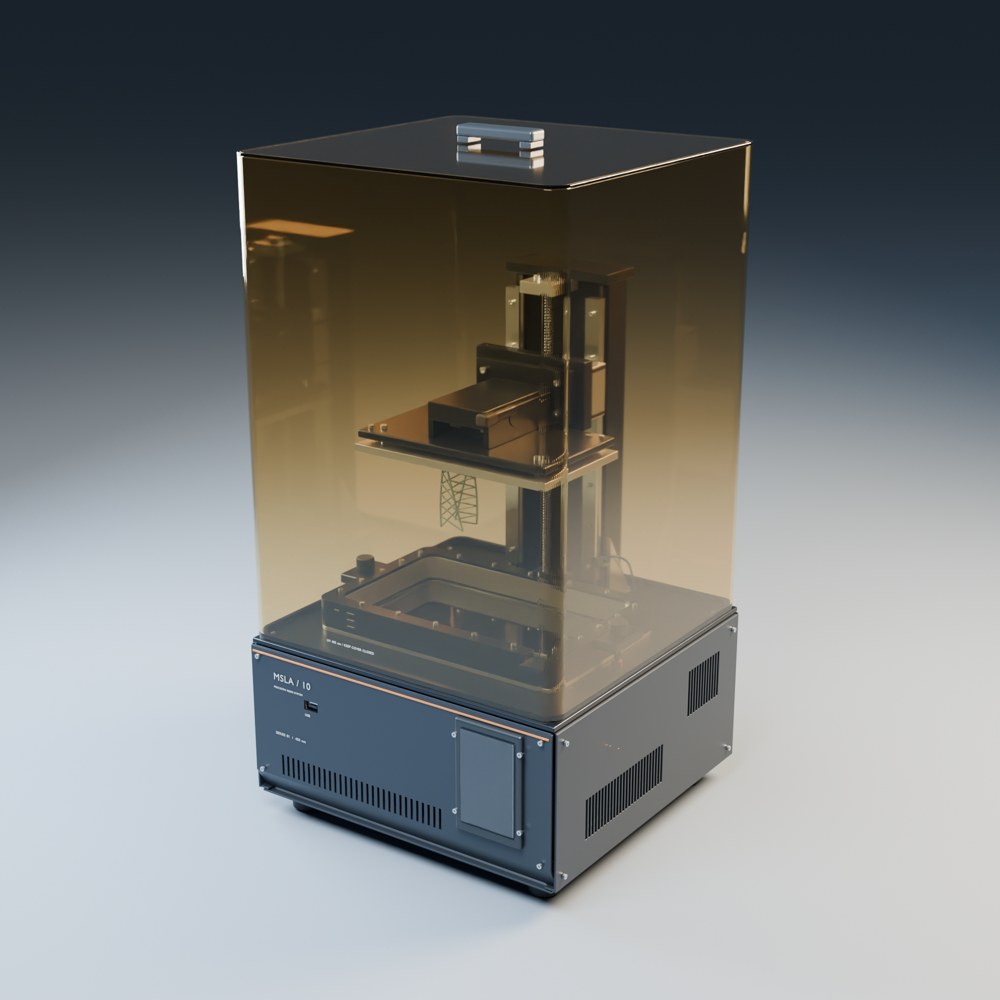
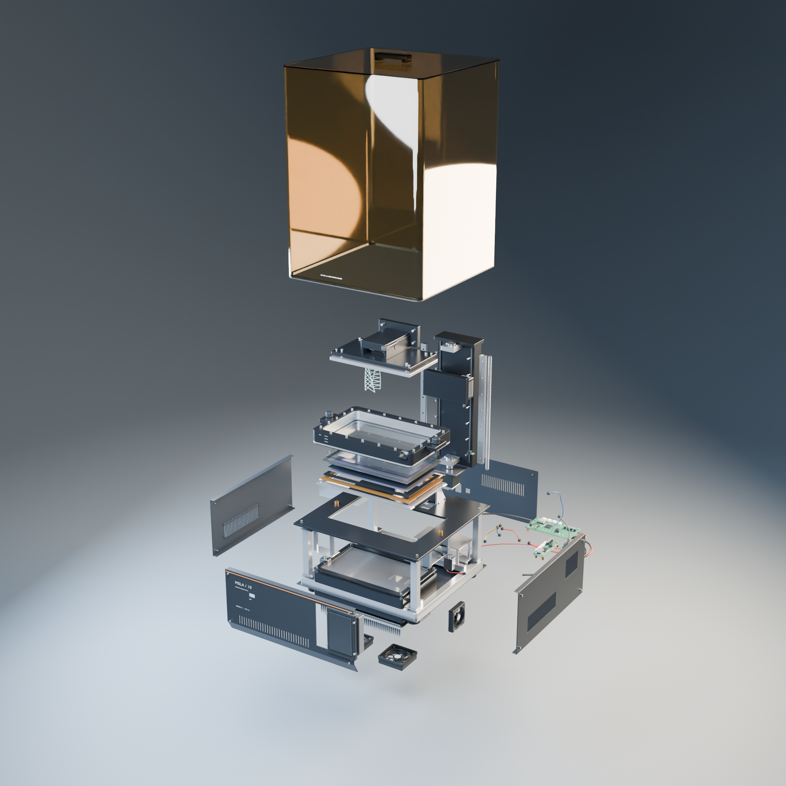

# MSLA / 10 — Resin 3D printer

An original, brand-neutral desktop MSLA resin printer for visualization, animation, and assembly exploration. Includes an editable Blender master, complete and explodable glTF models, six subsystem exports, and fourteen studio renders.



## Quick start

Download the repository ZIP or clone it:

```sh
git clone https://github.com/Darkamui/3d-resin-printer.git
```

Open the Blender master to edit the model, or import a GLB into a glTF-compatible viewer or engine. All assets are included directly; Git LFS and external textures are not required.

## Open the asset

- **[Blender master](resin_printer_master.blend)** — editable parts, materials, assembly hierarchy, studio cameras, optional resin, three print states and cutaway.
- **[Complete GLB](exports/resin_printer_complete.glb)** — assembled product with static hierarchy.
- **[Explodable GLB](exports/resin_printer_explodable.glb)** — independent parts, assembly metadata and a validation explosion animation.
- **[Hero render](renders/01_complete_hero.png)** and **[exploded render](renders/05_exploded_full.png)**.

The Blender timeline is a separation test: **frame 1 is assembled; frame 100 is exploded**. It is not a finished narrative animation. The master opens at frame 1.

## Organization and coordinates

- Meters, unit scale 1. Front −Y, right +X, up +Z in Blender. GLB uses the standard glTF Y-up conversion.
- Approximately 360 × 350 × 683 mm including the top handle. Shell roof is 665 mm; tower top is 535 mm. Dimensions of this fictional design are estimates.
- `Resin_Printer` contains numbered assembly collections. `ASM_` empties carry functional pivots; `CTRL_Printer` is the top-level transform.
- `EXPORT` links production objects only and is hidden in the studio to avoid overriding collection visibility. It is not a second physical model.
- `17_CUTAWAY` is an independent mesh variant. Hide the normal production collections before enabling it.
- `16_PRINT_SAMPLE` has `Print_10Percent`, `Print_50Percent` and `Print_Complete`. Enable one state at a time. Only the complete sample is in the main GLBs.
- `PRT_Optional_Resin` is hidden by default and excluded from GLB exports. Its surface is below the vat rim and above the film.

## Review images



All final images are 2000 × 2000 pixels, rendered in Cycles.

| Image | View |
|---|---|
| [01](renders/01_complete_hero.png) | Complete hero |
| [02](renders/02_front.png) | Front |
| [03](renders/03_back.png) | Rear |
| [04](renders/04_internal_no_panels.png) | Housing removed |
| [05](renders/05_exploded_full.png) | Exploded validation |
| [06](renders/06_build_plate_closeup.png) | Build platform |
| [07](renders/07_vat_closeup.png) | Resin vat |
| [08](renders/08_lcd_stack_exploded.png) | Exploded LCD layers |
| [09](renders/09_light_engine_exploded.png) | Exploded UV engine |
| [10](renders/10_z_axis_closeup.png) | Z mechanism |
| [11](renders/11_electronics_closeup.png) | Electronics and PSU |
| [12](renders/12_cutaway.png) | Independent cutaway |
| [13](renders/13_side.png) | Side |
| [14](renders/14_top.png) | Top |

Subsystem GLBs are in `exports/`: build plate, vat, LCD stack, Z axis, light engine and electronics. They retain the complete machine's coordinate system and relevant parent nodes.

## Validation and limitations

See [geometry audit](reports/geometry_audit.json), [GLB round-trip validation](reports/roundtrip_validation.json), [assembly manifest](reports/assembly_manifest.json), and [production log](docs/PRODUCTION_LOG.md).

The master has approximately 940k evaluated triangles. GLB export evaluates modifiers and converts curves/text to meshes; the Blender source remains editable. Coincident curve and text cap vertices are welded during export, and tiny triangulation slivers are removed. Material transmission requires glTF transmission support in the consuming renderer. The model has been reviewed visually and checked for geometry and export consistency, but is not a manufactured, electrically certified or mechanically simulated design. Fastener contacts, press fits and bonded layers intentionally touch or overlap.

## Reproduce

Built with Blender 5.2.1 LTS. Modeling scripts use Blender's bundled Python and require no additional packages. To rebuild, run the following in PowerShell from this directory, adjusting the executable path to your installation. Each command stops on a Python error; stage builds also render milestone previews and can take substantial time.

```powershell
$blenderExe = 'C:\Program Files\Blender Foundation\Blender 5.2\blender.exe'
1..7 | ForEach-Object {
    & $blenderExe --background --factory-startup --python-exit-code 1 --python scripts/build.py -- $_
    if ($LASTEXITCODE -ne 0) { throw "Build stage $_ failed" }
}
foreach ($script in @('finalize', 'repair_boards', 'export_assets', 'roundtrip', 'render_reviews')) {
    & $blenderExe --background --factory-startup --python-exit-code 1 --python "scripts/$script.py"
    if ($LASTEXITCODE -ne 0) { throw "$script failed" }
}
python scripts/check_delivery.py
```

`repair_boards.py` applies the final controller-board corrections after the staged build. `render_reviews.py` preserves existing final PNGs: remove the affected images before rebuilding to regenerate them. Rebuilding overwrites the master, exports, and reports. Checkpoints and milestone previews are generated locally and ignored by Git. Reference photographs are not required to build the model.

To verify the included assets with standard Python (no Blender required):

```sh
python scripts/check_delivery.py --verify
```

This checks all 23 delivery files, SHA-256 hashes, render dimensions, GLB containers, and recorded round-trip results. GitHub Actions runs this check on pushes and pull requests. To repeat the geometry, hierarchy, material, normal, and animation checks in Blender, run `scripts/roundtrip.py` using the Blender invocation above.

## License

The entire published project, including code, models, renders, and documentation, is available under the [MIT License](LICENSE).
